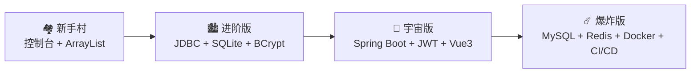

<div align="center">

# 学生成绩管理系统

**从 Java 控制台到企业级 Web —— 我的全栈成长之路**

`Spring Boot 3` · `Vue 3` · `Spring Security + JWT` · `JPA / H2(MySQL)` · `ECharts` · `Docker`

[功能演示](#-功能模块) · [技术栈](#-技术栈) · [快速开始](#-快速开始) · [演进历程](#-演进历程) · [工程实践](#-工程实践)

</div>

---

## 📖 项目简介

这是一个**渐进式全栈教学项目**，也是我从零开始学习 Java 后端开发的主线作品。我从只会最基础的 Java 语法起步，把同一个「学生信息管理」需求用四种方式逐步实现，每一代都引入新的企业级工程实践，最终完成了一个前后端分离、带权限控制和仪表盘可视化的 Web 系统。

通过这个项目，我完整走通了「需求 → 数据库设计 → 后端接口 → 前端页面 → 联调 → 部署」的全流程，并在过程中**独立修复了原项目的启动缺陷、将前端依赖本地化**，保证系统在国内网络环境下可一键运行。

> 面向岗位：Java 后端开发（Spring Boot + Vue + 微服务方向）

---

## ✨ 功能模块

| 模块 | 说明 |
|------|------|
| 🔐 登录注册 | JWT 双 Token 认证、密码 BCrypt 加密、注册/登录/找回密码 |
| 👨‍🎓 学生管理 | 学生信息增删改查、按姓名/院系搜索、分页、Excel 导入导出 |
| 📊 成绩管理 | 学生成绩录入、查询、统计 🚧（计划扩展模块） |
| 📈 仪表盘 | ECharts 可视化：院系分布、性别比例、总数统计 |
| 📋 操作日志 | AOP 切面自动记录用户操作，支持审计追溯 |
| 🛡️ 权限控制 | 基于角色的访问控制（ADMIN / TEACHER / STUDENT），方法级鉴权 |
| 📡 接口文档 | Knife4j / OpenAPI 3 自动生成 API 文档 |

---

## 🛠 技术栈

| 类别 | 技术 | 说明 |
|------|------|------|
| 后端框架 | Spring Boot 3.2 | REST API、自动配置、IOC/AOP |
| 安全认证 | Spring Security + JWT | 登录鉴权、双 Token 旋转 |
| 持久层 | Spring Data JPA / Hibernate | ORM 映射、分页查询 |
| 数据库 | H2（开发）/ MySQL 8（生产） | 内嵌零配置 / 生产级 |
| 缓存 | Redis 7 | 会话与查询缓存（爆炸版） |
| 前端 | Vue 3 + Vite + TypeScript | 单页应用（爆炸版）/ Vue3 CDN（宇宙版） |
| UI / 图表 | Element Plus / ECharts | 组件库 + 数据可视化 |
| 构建 | Maven | 依赖管理与构建 |
| 部署 | Docker + Compose + Nginx | 容器化一键部署 |
| CI/CD | GitHub Actions | 编译 → 测试 → 覆盖率 |

---

## 🚀 快速开始

### 方式一：宇宙版（零配置，推荐新手先跑这个）

无需安装数据库，内嵌 H2，一条命令启动：

```bash
cd universe
mvn spring-boot:run
```

打开浏览器访问：

- 应用首页：http://localhost:8080
- H2 控制台：http://localhost:8080/h2-console
- 默认管理员：`admin` / `admin123`

> 前端依赖（Vue、ECharts）已下载到本地 `static/js/`，无需联网即可渲染。

### 方式二：爆炸版（生产级，需 MySQL + Redis）

```bash
cd bigbang
docker-compose up -d
# 访问 http://localhost  管理员 admin / Admin@123
```

---

## 🗺 演进历程（我的学习路径）

同一个需求，四代实现，难度逐级递增，每一代都能独立运行：



| 版本 | 界面 | 数据库 | 安全 | 学到的核心 |
|------|------|--------|------|-----------|
| 🏘️ 新手村 | 控制台 | ArrayList（内存） | 无 | Java 基础、集合、面向对象 |
| 🏙️ 进阶版 | 控制台 | SQLite + JDBC | BCrypt | 分层架构、SQL、Maven 构建 |
| 🚀 宇宙版 | 浏览器 SPA | H2 + JPA | JWT | Spring Boot、REST 接口、前后端联调 |
| ☄️ 爆炸版 | 完整 Web 应用 | MySQL + Redis | JWT 双 Token | 缓存、Docker、CI/CD、工程化 |

---

## 🏗 系统架构（爆炸版）

```
┌──────────────────────────────────────────────────────┐
│              🌐 Nginx :80 (反向代理)                  │
│  ┌──────────────────┐    ┌──────────────────────┐    │
│  │  Vue3 + Vite+TS  │    │  Spring Boot 3 :8080 │    │
│  │  Element Plus    │◄──►│  Security + JWT      │    │
│  │  Pinia / ECharts │    │  AOP 日志 / 全局异常 │    │
│  └──────────────────┘    └──────────┬───────────┘    │
│                                     │                 │
│  ┌────────┐  ┌────────┐    ┌───────▼────────┐        │
│  │ MySQL 8│  │ Redis 7│◄──►│  业务服务层     │        │
│  └────────┘  └────────┘    └────────────────┘        │
└──────────────────────────────────────────────────────┘
```

---

## 🎯 工程实践

- **分层架构**：Controller → Service → Repository，职责清晰
- **JWT 双 Token**：Access Token（1h）+ Refresh Token（7d）无感刷新
- **AOP 日志切面**：零侵入记录操作日志与 IP
- **全局异常处理**：`@RestControllerAdvice` 统一异常返回
- **参数校验**：`@Valid` + Bean Validation
- **数据库版本迁移**：Flyway 管理 DDL 演进（爆炸版）
- **Redis 缓存**：`@Cacheable` 减少数据库压力
- **前后端分离**：Nginx 反向代理 + Vite 开发代理
- **CI/CD**：GitHub Actions 自动化构建测试

---

## 📂 项目结构

```
student_management/
├── Student_manage/          # 🏘️ 新手村：控制台 + ArrayList
├── src/main/java/           # 🏙️ 进阶版：JDBC + SQLite + MVC 分层
├── universe/                # 🚀 宇宙版：Spring Boot + JWT + Vue3（零配置可跑）
│   └── src/main/resources/static/   # 前端页面（Vue3 CDN 本地化）
├── bigbang/                 # ☄️ 爆炸版：MySQL + Redis + Docker
├── bigbang-frontend/        # 爆炸版前端：Vue3 + Vite + TS
└── docs/                    # 文档与图片
```

---

## 📌 我的收获

1. 系统掌握了 **Spring Boot + Vue3** 前后端分离开发的完整流程
2. 理解了 **JWT 鉴权、AOP、全局异常处理、分层架构** 等企业级实践
3. 学会了用 **Docker Compose** 编排多服务部署
4. 培养了**排错能力**：独立定位并修复了 `data.sql` 执行顺序导致的启动失败、CDN 加载失败导致的前端白屏等问题

---

<div align="center">
  <sub>基于 <a href="https://github.com/lechan775/student_management">lechan775/student_management</a> 学习与改进 | 使用 Spring Boot & Vue 3 构建</sub>
</div>
